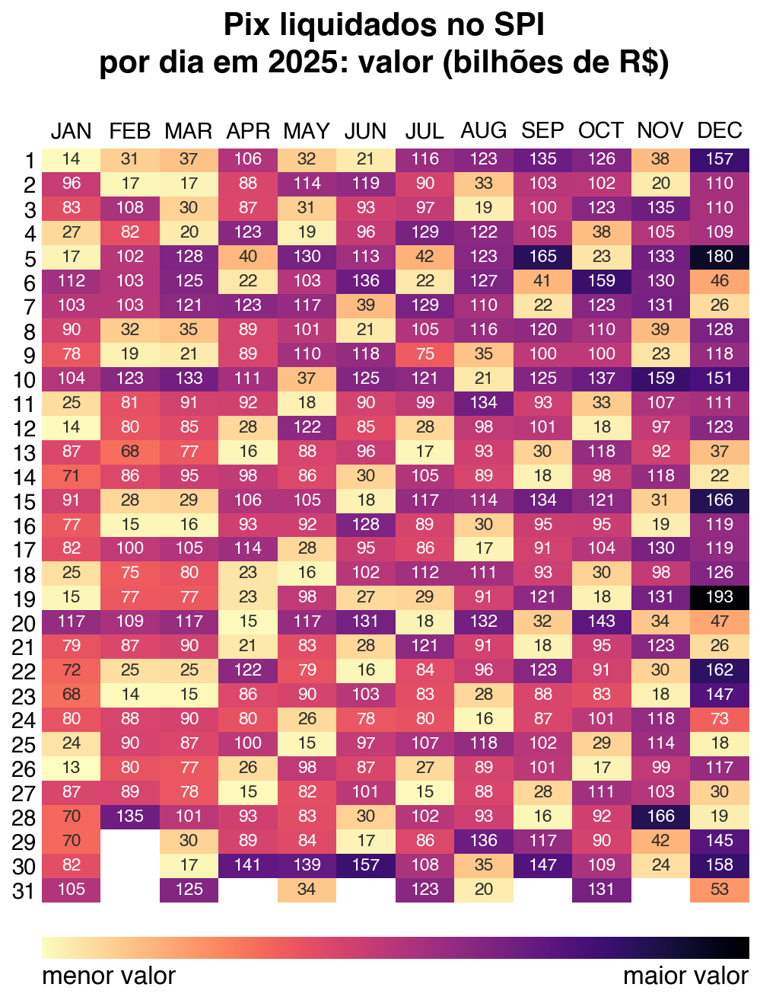

# Pix por dia: mapa de calor diário

Mapa de calor (heatmap) com o número (ou o valor) de Pix por dia, um para
cada ano: cada célula é um dia do ano (eixo X = mês, eixo Y = dia do mês),
colorida pela quantidade ou pelo valor.



## O que gera

Em `output/`:
- `pix_daily_heatmap_<ano>.png`: **quantidade** de Pix por dia.
- `pix_daily_heatmap_value_<ano>.png`: **valor** (R$) por dia.

## Como rodar

```bash
pip install -r requirements.txt
python daily_heatmap.py            # último ano completo, quantidade
python daily_heatmap.py 2025       # ano específico
python daily_heatmap.py 2025 value # valor (R$)
```

## Dados (crus, sem transformação)

`data/pix_liquidados_atual.csv` é o dado **cru** da API (valores originais, sem
limpeza). Colunas: `Data, Quantidade, CanalPrimario, CanalSecundario, Total,
Media`.

Observação de unidade: a coluna `Total` vem em **milhares de reais** e o script multiplica por 1000 para exibir em reais.

Os números são do Pix liquidado entre instituições diferentes (não incluem as
transferências dentro do mesmo banco).

## Como o dado foi baixado (para auditar)

```bash
python download_data.py
```

Endpoint (BCB, Olinda OData v1):

```
https://olinda.bcb.gov.br/olinda/servico/SPI/versao/v1/odata/PixLiquidadosAtual?$format=json&$top=200000
```
