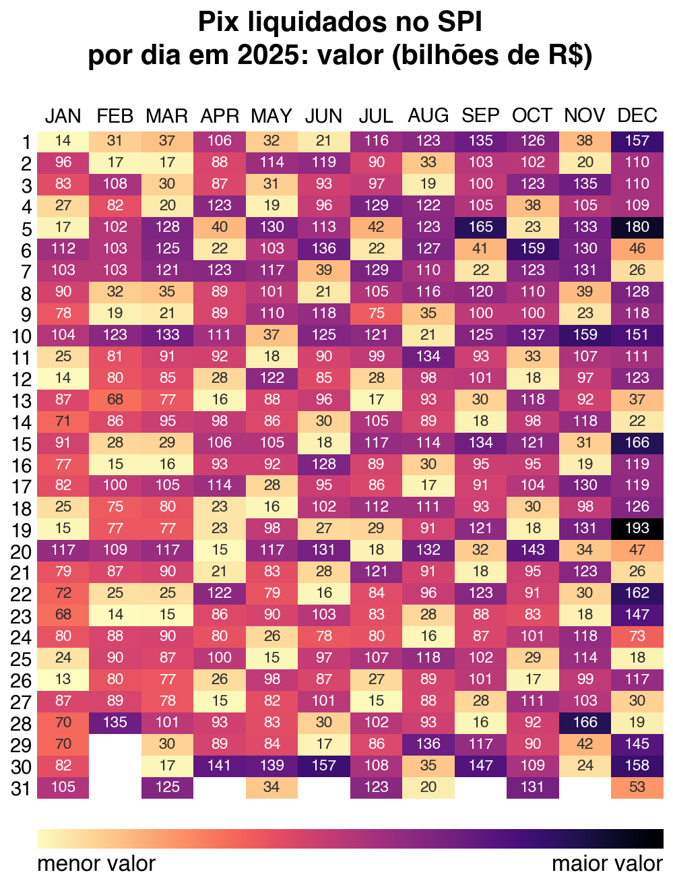

# Nos fins de semana, o valor do Pix cai bem mais que a quantidade

Analisamos dados abertos do Banco Central sobre o Pix liquidado por dia, de 2021
a 2026, em dois mapas de calor: quantidade e valor. Cada célula é um dia do ano,
cada coluna um mês.

As diagonais mais claras que cortam os mapas são os fins de semana. Como sábado
e domingo caem em dias diferentes a cada mês, eles formam faixas diagonais.

O curioso é que essas diagonais ficam bem mais evidentes no mapa de valor do que
no de quantidade. Em 2025, a quantidade de Pix no fim de semana é 13% menor que num dia útil:
176 milhões contra 203 milhões. Já em valor, a queda é de 76%: 25,1 bilhões de
reais por dia contra 103,5 bilhões num dia útil.

A explicação está no valor de cada transação. No fim de semana o valor médio por
transação despenca de 504 para 139 reais. Isso pode ser porque as empresas, que
movem o dinheiro grande, operam menos no fim de semana, ou porque as pessoas
gastam menos quando não vão trabalhar.

Essa diferença vem mudando. A queda de quantidade no fim de semana era de 36% em
2021 e caiu para 13% em 2025: o Pix virou rotina de todo dia. A queda de valor,
porém, permanece entre 75% e 79% desde 2021.
